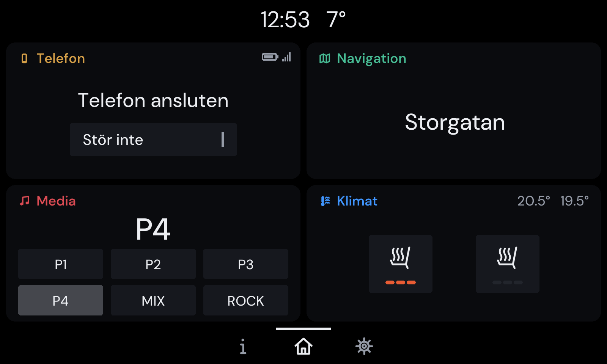
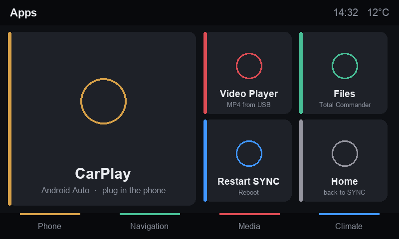

# sync-redesign

A new look for Ford's SYNC 2 (MyFord Touch, 8" screen), and a quicker feel, done in small
steps that can always be undone. The companion of
[sync2-auto-magic](https://github.com/Theralley/sync2-auto-magic), which builds the USB job
sticks this project uses to read from and write to the car.



**The aim right now: version 2** (our own drawing above, `tools/mockup_v2.py`). The frame and Home
are rebuilt on one 8 px grid instead of repainted:
- four equal cards, each with a heading in its area's colour;
- on Home, black bars with only the clock on top, and Info, Home and Settings below;
- flat buttons without outlines;
- flat side menus in Settings and Info.

**Status (2026-11-03):** version 2 has run in the car. It changed 14 of Ford's start-up files at
once, and every part was verified byte for byte. Its three faults are fixed for the next visit
(the seventh): the presets' outlines out of place, a stray label in the climate card, and grey
edges on the areas' own screens. What each visit changed and showed is in
[docs/FINDINGS.md](docs/FINDINGS.md); the car tests, step by step, in [docs/BILTEST.md](docs/BILTEST.md)
(Swedish). Next: the phone screen's own glossy menu (`Phone.swf`).

## What SYNC 2's screens are

- Flash files (`.swf`, SWF version 8, ActionScript 2) with PNG and JPG pictures, in
  `\8inchSkins\Ford\Sync\Apps\<area>\<screen>\` on the car, shown by `Desktop.exe`.
- The screen is 800x480; the area above the bottom bar, where the wallpaper goes, is 800x378.
- The code has a theme layer (`SyncThemeUtil`, `SyncThemeButtonArt`, `SetSmartSkins`, day and
  night buttons, colours per area). SyncExtPack already replaces two of Ford's screens, so
  changed screens do load.

The whole plan, with what is known and the safety rules: [docs/PLAN.md](docs/PLAN.md).
How to undo any change, step by step: [docs/RECOVERY.md](docs/RECOVERY.md).
The plan for a new menu, with a first mock-up: [docs/MENU-PLAN.md](docs/MENU-PLAN.md).
The plan for a completely new interface, with sketches per screen: [docs/REDESIGN-PLAN.md](docs/REDESIGN-PLAN.md).
Its review from the driver's seat (glance, gloves, climate, icons, language, performance):
[docs/UX-REVIEW.md](docs/UX-REVIEW.md).
Speed on the map: [docs/SPEED.md](docs/SPEED.md). A night screen, and album covers over Bluetooth:
[docs/NIGHT.md](docs/NIGHT.md). Spotify on SYNC 2, which way: [docs/SPOTIFY.md](docs/SPOTIFY.md).
The next car test, step by step (Swedish): [docs/BILTEST.md](docs/BILTEST.md).



## Changing the colours

With sync2-auto-magic, after a drive log:

```sh
python3 -m s2am job theme --preset lincoln --serial YOURSERIAL      # the change stick
python3 -m s2am job theme --restore <that job> --serial YOURSERIAL  # its undo stick, built at once
```

The change backs up the five theme files on the car and the stick, copies the new ones in and
restarts SYNC; the Mac checks every byte after import. The undo stick carries the originals.

## A new Apps menu

The Apps menu (where AutoKit, Video Player and Total Commander live) becomes a grid of big
tiles: CarPlay first, three small tiles, and "All apps", which shows the old list. It is
SyncExtPack's file, not Ford's, and SYNC loads it only when Apps is opened.

```sh
python3 tools/make_tiles.py tiles/
python3 tools/build_apps_menu.py ~/.s2am/SERIAL/reports/<drive log>/skins/8inchSkins/Ford/Sync/Apps/Info/SyncApps/SyncApps.swf SyncApps-tiles.swf
python3 -m s2am job apps-menu --swf SyncApps-tiles.swf --tiles tiles/ --serial YOURSERIAL   # change stick
python3 -m s2am job apps-menu --restore <that job> --serial YOURSERIAL                     # undo stick
```

SyncExtPack publishes its menu without a licence, so this repository never holds its code:
the build changes your own copy on your Mac.

## Collecting data from the car

With sync2-auto-magic, a drive logger stick:

```sh
python3 -m s2am job logger --drive --serial YOURSERIAL
python3 -m s2am stick prepare /Volumes/STICK --job <the job folder it prints>
# in the car: insert, leave it in while you drive, pull it at the end
python3 -m s2am stick import /Volumes/STICK
python3 -m s2am report --serial YOURSERIAL
```

It records the system's facts, processor load and memory every 10 s, a list of every file, a
copy of `\8inchSkins` with SHA-256 hashes, and a screenshot whenever the screen changes. It
only reads from the car.

## Tools

| Tool | What it does |
|---|---|
| `tools/swftags.py FILE.swf` | Lists an SWF's tags, its exported ActionScript 2 classes and the strings in its code. No Java needed |
| `tools/mockup_apps_menu.py OUT.png` | Draws the Apps menu mock-up (our own drawing, Pillow) |
| `tools/make_tiles.py OUTFOLDER [--lang sv\|en]` | Draws the tile pictures for the new Apps menu (our own drawings), Swedish by default, full colour but compact |
| `tools/make_theme.py CAR_THEMES OUT [--borderless [--palette night\|deep\|v2]] [--no-glow]` | The "Night" colours: the car's own Theme.XML and gradients, recoloured in exactly their format; `--borderless` gives every button's outline the button's own colour (`v2`: 0x16181E, the chips22 strip), `--no-glow` makes the four area glows black |
| `tools/preview_screens.py CAR_APPS OUT` | Renders Ford's screens on the Mac (FFDec) as a baseline; keep the pictures private |
| `tools/mockup_redesign.py OUT [--lang sv\|en]` | Draws the redesign sketches (our own drawings), Swedish by default, and prints how much light the night screen gives off |
| `tools/mockup_v2.py OUT.png [--scale N]` | Draws the aim right now, version 2's Home (our own drawing, `docs/mockups/v2-home.png`), with the grid, colours and font the build tools use |
| `tools/icons.py` | The redesign's one icon family (43 icons, climate and call symbols after Ford's own), used by the tiles, the sketches and the screens; `python3 -m unittest discover tests` checks it |
| `tools/swf_bitmaps.py IN.swf --list` / `IN.swf OUT.swf ID=pic.png ...` | Replaces pictures inside a Flash file at their exact size (lossless, and JPEG3 kept as JPEG3 with its alpha) and proves every other tag stayed byte for byte. No Java |
| `tools/restyle_frame.py CAR_APPCONSOLE OUT_SWF [--palette night\|deep\|v2] [--straight] [--radius N] [--preview DIR]` | Phase R4a: **your car's own** frame (`AppConsole.swf`) restyled: 135 pictures redrawn flat at their sizes (`tools/restyle_art.py`): the strips SYNC tiles across every button on every screen, the bars round the screen, their pieces and icons, the indicator lights. `--palette deep` near black for the car's screen, `--straight` the bars straight across without Ford's slanted pieces. No code unless `--radius`. Checks every tag; refuses a file that is not the frame it was made for. Keep OUT and DIR private |
| `tools/build_phone_history.py CAR_SWF OUT_SWF [--rows] [--preview DIR]` | Phase R3: **your car's own** call history screen with our icons (R3a: eight pictures, no code) and, with `--rows`, big rows (R3b: 76 px, three to a page, the name 26 px; two numbers changed in place, the row's layout through FFDec's XML form). Checks every tag and reads every value back; refuses a file that is not the screen it was made for. Keep OUT and DIR outside this repository: they hold Ford's code and artwork |
| `tools/build_apps_menu.py CAR_SWF OUT_SWF` | Builds the tiled Apps menu from **your car's own** SyncApps.swf: adds `tools/apps_menu_tiles.as` with FFDec (pinned, in Docker) and checks that only one class changed |
| `tools/build_frame.py CAR_APPS OUT [--preview DIR]` | Frame v2 (the sixth visit): **your car's own** frame files, written under OUT at their Apps-relative paths. `AppConsole.swf` in the `v2` palette: black tabs and clock piece without lines, the launch pieces Info/Home/Settings as flat cells (icon grey, white + a 3 px line when selected), the 76 button strips in "chips22" so buttons show on the Home cards, three placements moved in place. The five console objects: texts on one baseline, the clock centred, the media icon before its text, and on Home only the clock and the launch buttons remain (the phone's and climate's Home-only clips off the stage, one boolean in `NavConsoleObject`, two constant-pool strings in `MediaConsoleStrings`, in `MediaConsoleObject.swf` and in `Media.swf`). Then `build_menus.py` and, when `Themes` sits beside `Apps`, `make_theme.py --borderless --palette v2 --no-glow`. Nothing recompiled; checks every tag, reads every picture, placement and patched byte back; refuses a file that is not the one it was made for, and refuses to write a result as long as the car's file (s2am checks a copy on the car by its size, so where nothing else changes the length one moved placement's matrix is encoded one field wider). Keep OUT and DIR private |
| `tools/build_menus.py CAR_APPS OUT [--preview DIR]` | Frame v2's side menus: **your car's own** `Menu/Menu.swf` (Settings) and `Info/Info.swf` with their glossy 150x50 glass pictures and 153x306 panels replaced flat at their sizes (a 2 px gap, the card colour, Info's selected pictures with a 3 px line on the left); the Settings menu's selected row is SYNC's shared strip. Checks every tag; refuses a file that is not the menu it was made for |
| `tools/swf_place.py IN.swf SPRITE\|main DEPTH CHARACTER` | Reads a placement's translation; as a library (`move`) rewrites it in place at the same bit width, or re-encodes just that matrix when a value needs more bits, and reads it back. `tools/swf_actions.py` is its companion for ActionScript 2 byte code: one boolean in a branch found by the instructions round it, a constant-pool string of the same length. No Java |
| `tools/build_home.py CAR_APPS OUT [--preview DIR] [--photo FILE]` | Home v2 (the sixth visit): **your car's own** Home screen as an aligned 2x2 grid: `Home/Home.swf` (a start-up file) gets four flat cards (x 8-396/404-792, y 56-236/244-424, radius 12) and our headings, an area icon and "Telefon" / "Navigation" / "Media" / "Klimat" in the area colour as vector art set in DM Sans (`fonts/`, OFL) through `glyphs.py`, in place of Ford's two divider shapes; the screen filter made opaque; the eight numbers that place the four quadrant files changed in place in the class Home (one an AS2 double); nothing recompiled, no tag added. Runs `build_corners.py` for the quadrant files. Only the intended tags come from FFDec's output; checks every file tag by tag and reads every value back; refuses files that are not the ones it was made for. `--preview` renders the result with the quadrant files in an idle state (three pictures: run-time chip colour, lighter chips, sample temperatures) and prints measured screen positions. Keep OUT and DIR private |
| `tools/build_corners.py CAR_APPS OUT` | Home v2's quadrant files: **your car's own** `Phone/PhoneSmartCorner.swf`, `Nav/NavSmartCorner.swf`, `Media/MediaSmartCorner.swf`, `Climate/ClimateSmartCorner.swf` laid out for the cards through FFDec's XML form (one table of placement moves, scales and text-field sizes): status icons on the heading line, the compass ball off-stage, the station name centred and six preset chips filling the card, the seat buttons larger and centred, the theme's outline clip of the preset and "do not disturb" buttons scaled to nothing. One code change in place: the two numbers of PhoneSmartCorner's icon layout (200, 0.5 -> 385, 1), so the icons end at the card's right margin. Every button keeps its hit clip, label clip and press/release handling. Checks every file tag by tag (a placement may differ in its matrix only, a text field in size, bounds, alignment and colour only, the phone class in twelve bytes only) and reads every value back |
| `tools/xmlswf.py` | Library for the two above: FFDec's XML form (find a Define tag, a container, a placement; write a matrix; solid-colour shapes from rounded rectangles, polygons and circles; read a shape back), splicing only the intended tags from FFDec's rebuilt file into the car's bytes (whole tags, main-timeline placements, placements inside a sprite), placements split into their fields, a class's pushes with offsets (to change a number in place) and the tag-by-tag check |
| `tools/glyphs.py` | Text as shape edges from `fonts/DMSans[opsz,wght].ttf` (OFL): the variable font instanced with fontTools at weight 560 and optical size 14, each glyph's TrueType outline as lines and quadratic curves in twips, contours reversed so holes cut out; no font tag, no device font, nothing of Ford's font setup |

## Rules

- **Ford's files never go into this repository**: no screens, no decompiled code, no copies
  from the car, and no screenshots (they can show names and places from your phone). They stay
  on your Mac, in `~/.s2am/`. `.gitignore` blocks `*.swf`, `*.bmp` and the dump folders.
- The repository holds only our own tools and our own artwork. Changed screens are built on
  your Mac from your car's own files.
- Every change comes with a backup on the car and an undo stick, made before the change.

## License

MIT, for this repository's own code and artwork. Ford's files are Ford's.
